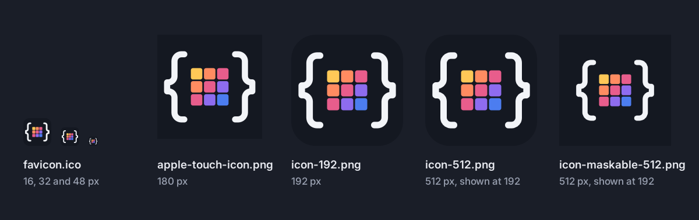

# Generate favicons

A site needs a handful of icons: one for the browser tab, one for iOS' home screen, and a few for the web app manifest.
One script makes them all from your logo, as an SVG or a square PNG, and the logo's SVG doubles as the modern favicon.



## The script

Save it as `favicons.mjs` and run `node favicons.mjs logo.svg public '#141821'`. The last argument is the background
color of the icons that can't be transparent (a six-digit hex color, white by default).

```js
// node favicons.mjs <logo.svg or logo.png> [output directory] [background color]
// Writes the icons a website needs from one logo: favicon.ico, icon.svg (for an SVG logo), apple-touch-icon.png,
// icon-192.png, icon-512.png and icon-maskable-512.png
import { copyFile, mkdir, readFile, writeFile } from 'node:fs/promises';
import { Image } from 'imagescript';

const [source, outDir = 'public', background = '#ffffff'] = process.argv.slice(2);
if (!source) throw new Error('Usage: node favicons.mjs <logo.svg or logo.png> [output directory] [background color]');
const backgroundColor = Number.parseInt(background.replace('#', '') + 'ff', 16); // '#141821' -> 0x141821ff

const bytes = await readFile(source);
const isSVG = source.toLowerCase().endsWith('.svg');
const png = isSVG ? null : await Image.decode(bytes);
if (png && (png.width !== png.height || png.width < 512)) throw new Error('A PNG logo has to be square and at least 512 pixels');

// the logo at a size, with a transparent background
const logo = async (size) => isSVG
  ? Image.renderSVG(bytes, { width: size })
  : png.clone().resize({ width: size, height: size, mode: 'area' });

// the logo on a solid background, with an empty margin around it (a share of the size)
async function onBackground(size, margin = 0) {
  const inner = Math.round(size * (1 - margin * 2));
  return new Image(size, size).fill(backgroundColor).composite(await logo(inner), { x: Math.round((size - inner) / 2), y: Math.round((size - inner) / 2) });
}

// favicon.ico: a small header, then the images: modern browsers and Windows read PNG files inside it
function ico(images) {
  const total = images.reduce((sum, { bytes }) => sum + bytes.length, 0);
  const out = new Uint8Array(6 + 16 * images.length + total);
  const view = new DataView(out.buffer);
  view.setUint16(2, 1, true); // type: icon
  view.setUint16(4, images.length, true);
  let offset = 6 + 16 * images.length;
  images.forEach(({ size, bytes }, i) => {
    const entry = 6 + 16 * i;
    out[entry] = size; // width and height in pixels (0 would mean 256)
    out[entry + 1] = size;
    view.setUint16(entry + 4, 1, true); // color planes
    view.setUint16(entry + 6, 32, true); // bits per pixel
    view.setUint32(entry + 8, bytes.length, true);
    view.setUint32(entry + 12, offset, true);
    out.set(bytes, offset);
    offset += bytes.length;
  });
  return out;
}

await mkdir(outDir, { recursive: true });
const write = async (name, data) => { await writeFile(`${outDir}/${name}`, data); console.log('wrote', `${outDir}/${name}`); };

await write('favicon.ico', ico(await Promise.all([16, 32, 48].map(async (size) => ({ size, bytes: await (await logo(size)).encodePNG() })))));
if (isSVG) { await copyFile(source, `${outDir}/icon.svg`); console.log('wrote', `${outDir}/icon.svg`); }
await write('apple-touch-icon.png', await (await onBackground(180)).encodePNG()); // iOS paints transparency black
await write('icon-192.png', await (await logo(192)).encodePNG());
await write('icon-512.png', await (await logo(512)).encodePNG());
await write('icon-maskable-512.png', await (await onBackground(512, 0.1)).encodePNG()); // Android may cut the outer 10% off
```

It writes these files into the directory:

- `favicon.ico` with images of 16, 32 and 48 pixels. ImageScript doesn't write `.ico` files, but an `.ico` file is a
  short header followed by PNG images, and the script writes the header itself.
- `icon.svg`, a copy of an SVG logo, which browsers scale to any size.
- `apple-touch-icon.png`, 180 pixels. iOS paints transparent pixels black, so it gets the background color.
- `icon-192.png` and `icon-512.png` for the web app manifest.
- `icon-maskable-512.png`, with the logo inside the inner 80 percent on the background color: Android may crop the
  icon to a circle or a rounded square.

The whole run takes about half a second. A PNG logo has to be square and at least 512 pixels, since the icons are made
by shrinking it.

## Using the icons

Put these in the `<head>` of every page:

```html
<link rel="icon" href="/favicon.ico" sizes="32x32">
<link rel="icon" href="/icon.svg" type="image/svg+xml">
<link rel="apple-touch-icon" href="/apple-touch-icon.png">
<link rel="manifest" href="/manifest.webmanifest">
```

and this in `manifest.webmanifest`:

```json
{
  "name": "Example",
  "icons": [
    { "src": "/icon-192.png", "type": "image/png", "sizes": "192x192" },
    { "src": "/icon-512.png", "type": "image/png", "sizes": "512x512" },
    { "src": "/icon-maskable-512.png", "type": "image/png", "sizes": "512x512", "purpose": "maskable" }
  ]
}
```

## Notes

- **Small sizes need their own drawing.** A logo with fine detail turns to mush at 16 pixels. Give the script a simpler
  SVG for the icon (the mark without the wordmark, thicker strokes) than the one on your pages.
- **SVG favicons can follow the dark mode.** An SVG with a `<style>` block and `@media (prefers-color-scheme: dark)`
  changes its colors with the browser's theme; the PNG files don't.
- **Fonts in an SVG logo.** ImageScript doesn't use the fonts installed on a machine: text in an SVG is only drawn with
  a font you pass in the `font` option of {@link Image.renderSVG}, and not at all without one. Convert the text to paths
  in your editor before you use the logo here.
